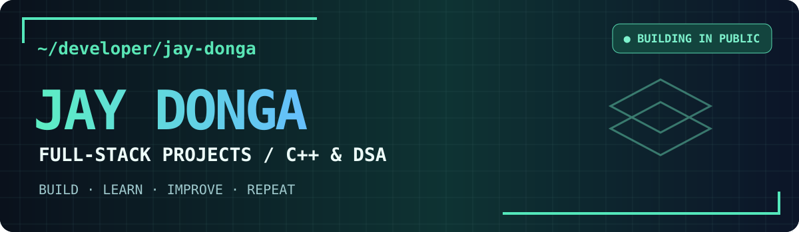
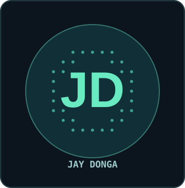
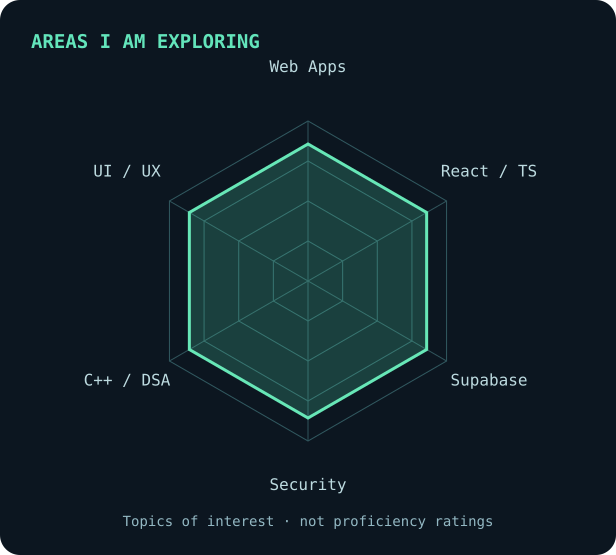
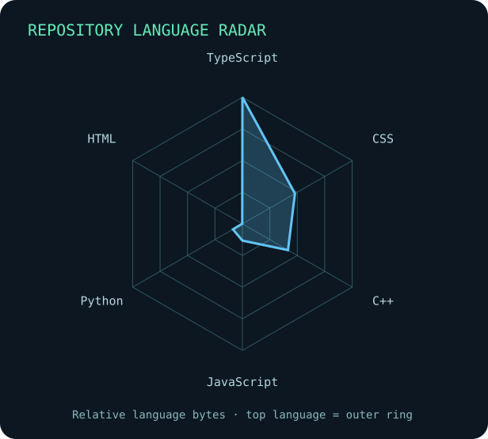
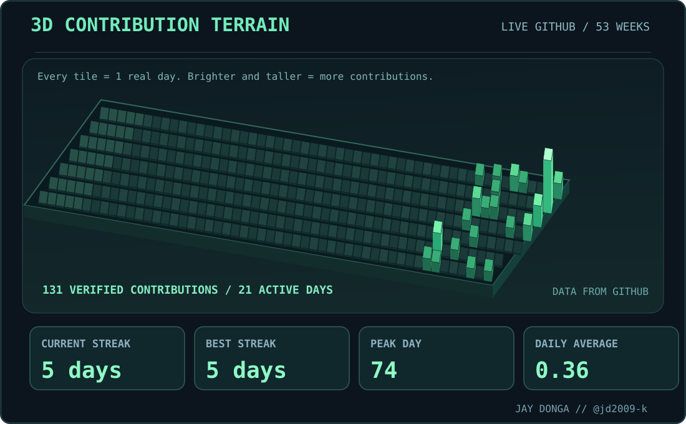
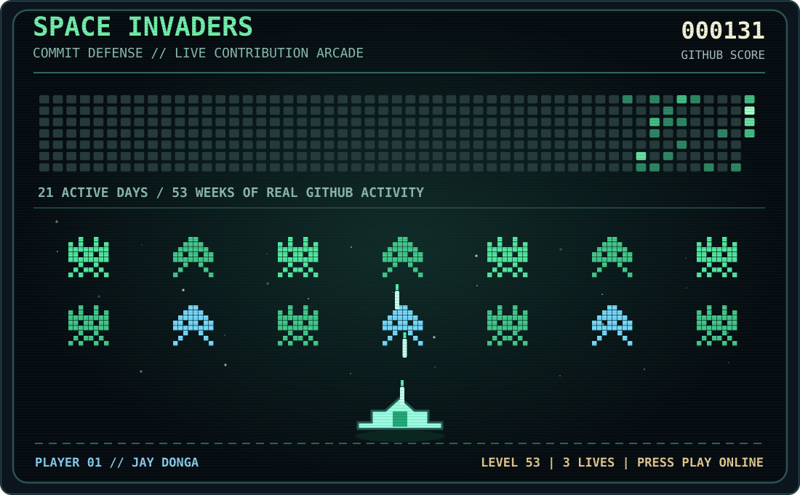
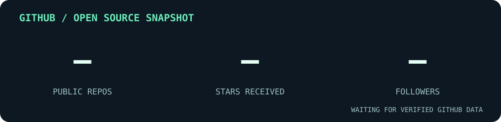
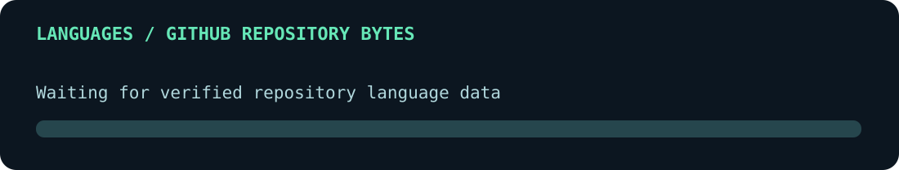
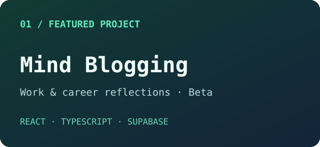
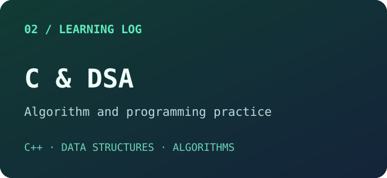

 

---

## `~/` whoami

<table><tr>
<td width="28%" align="center" valign="middle"></td>
<td valign="middle">
<pre><code>$ whoami
Jay Donga

$ cat focus.txt
Web apps · C++ / DSA · Product thinking

$ echo $MINDSET
"Build, learn, improve, repeat."</code></pre>

I'm a developer who enjoys turning ideas into useful applications and sharpening my problem-solving skills. I work on <strong>modern web projects</strong> while learning <strong>C++ and data structures &amp; algorithms</strong>. I care about thoughtful interfaces, maintainable code, security, and testing.

<ul>
<li><strong>Building:</strong> <a href="https://github.com/jd2009-k/mind-blogging">Mind Blogging</a>, a work-and-career reflection and progress-tracking app (beta).</li>
<li><strong>Practicing:</strong> <a href="https://github.com/jd2009-k/c-and-DSA">C &amp; DSA</a>, programming and problem-solving exercises.</li>
<li><strong>Exploring:</strong> React, TypeScript, Supabase, deployment workflows, and responsible AI-assisted development.</li>
</ul>
</td></tr></table>

---

## `~/` toolbox

Tools I use or am actively learning; this is not a claim of mastery.

---

## `~/` technology radar

<table><tr><td width="50%">

</td><td width="50%">

</td></tr></table>

The left graphic represents areas of focus, **not proficiency ratings**. The right chart is generated from public repositories when the automated workflow runs.

---

## `~/` contribution space

Visuals refresh from GitHub's contribution calendar where API access permits. [Open GitHub's official contribution graph](https://github.com/jd2009-k?tab=overview).

---

## `~/` the numbers

<picture>
  <source media="(prefers-color-scheme: light)" srcset="assets/stats-light.svg" />
  
</picture>

 

Counts and code-byte shares come from GitHub, refreshed by [this workflow](.github/workflows/refresh-profile.yml). Some metrics initially show pending until the first workflow run.

---

## `~/` selected work

<table>
<tr>
<td width="50%" valign="top">

<strong><a href="https://github.com/jd2009-k/mind-blogging">Mind Blogging</a></strong>

A work-and-career journaling application for recording reflections, progress, goals, and evidence of work. A live <strong>beta</strong>—not presented as a fully tested production release.

<code>React 19</code> <code>TypeScript</code> <code>Supabase</code> <code>Vercel</code>

<a href="https://github.com/jd2009-k/mind-blogging">Repository</a> · <a href="https://mind-blogging-jd-ff4c.vercel.app/">Live beta</a>

</td>
<td width="50%" valign="top">

<strong><a href="https://github.com/jd2009-k/c-and-DSA">C &amp; DSA Practice</a></strong>

A growing collection of programming exercises that document my progress with C++ and problem-solving fundamentals.

<code>C++</code> <code>Data Structures</code> <code>Algorithms</code>

<a href="https://github.com/jd2009-k/c-and-DSA">Explore source</a>

</td>
</tr>
</table>

---

### `~/` connect

Want to collaborate, review code, or talk about an idea? Find me at **[github.com/jd2009-k](https://github.com/jd2009-k)**.

Inspired by developer-profile design patterns, built for Jay Donga with original assets and verified projects.

